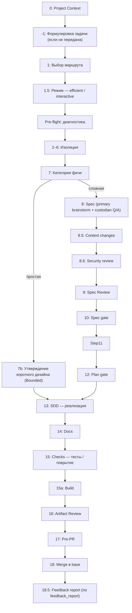
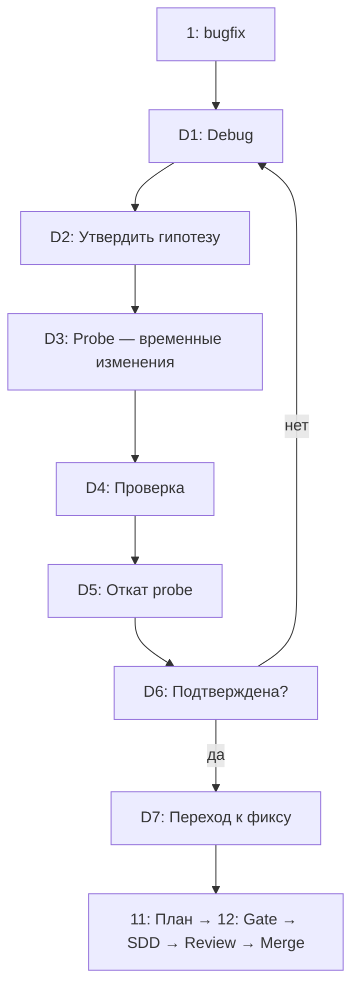

# Всё: pipeline — Feature, Bugfix и Spike

[Назад к оглавлению](../index.md)

## 🎯 Назначение

Сквозной обзор pipeline скилла `maestro`: что происходит от входа `@maestro-init` до мержа в base. **Три маршрута на шаге 1:**

1. **Feature-маршрут** (шаги 0–18.5) — от brainstorm до merge, полный цикл.
2. **Bugfix-маршрут** (шаги 0–6 → D1–D7 → 11–18.5) — багфикс с debug sub-pipeline, без spec.
3. **Spike** (шаги 0–1, spike-гейты) — feasibility/ресеч/прототип, **без spec/plan/мержа**, throwaway-код.

Вход — команда `@maestro-init` в любой primary-сессии. Оркестратор проходит через
**HITL-гейты** — явные вопросы с вариантами (a)/(b)/(c). На каждом гейте пользователь подтверждает действие.

> **Гейт 0 (предварительный): плагин `maestro-bootstrap` работает.** Если плагин не
> загружен — жёсткий STOP, pipeline не продолжается (защита confidential-данных).
> Без работающего плагина авто-режимы не стартуют вообще.

> Полная спецификация — `skills/maestro/SKILL.md`. Здесь — пользовательский обзор «как устроен pipeline и почему».

---

## Feature-маршрут (0–18.5)

### Предисловие

Пользователь вызывает `/maestro-init`. Если задача не передана — бот формулирует её из контекста текущей сессии и показывает для HITL-подтверждения (шаг -1). Затем оркестратор загружает
project context, запускает pre-flight, определяет категорию фичи, и проходит
через pipeline (зависит от категории — простая или сложная).

**Быстрый маршрут для простых фич:** категория **простая** (1–2 файла) →
`0→2→6→7b→13→14→15→15a→16→17→18→18.5`. Шаги 8–12 **не выполняются**:
вместо spec (8) — короткий дизайн в чате, вместо плана (11) и гейта плана (12) —
**HITL-гейт 7b** (утверждение короткого дизайна). **Шаг 17 (Pre-PR, ⚑1) обязателен**
для всех категорий — без явного approve мерж не выполняется ни в одном режиме.
**Шаг 14 (документация) обязателен** для всех категорий.

### Шаг за шагом

| # | Шаг | Назначение |
|---|---|---|
| 0 | Project Context | Загрузка проекта контекста из `docs/project-context.md` (или создание через HITL). **Memory layer:** старт Plan-фазы — минимум 1 `memory_search` по теме задачи до первого дизайн-вопроса пользователю (обязательно; память не включена → молча пропуск; канон — `skills/maestro/references/memory-layer.md`). **Confidential notice:** если `confidential.paths` непуст — до начала работы одна строка о потоке данных (primary-модель; сабагентам — только замаскированные тексты); информационно, не гейт |
| -1 | Формулировка задачи | Если `@maestro-init` без задачи — бот формулирует её из контекста сессии → HITL: принять / переформулировать / отмена. Если задача уже определена (параметр) — шаг пропускается |
| 1 | Выбор маршрута | Feature / Bugfix / Spike? Определяет дальнейший путь. Spike — feasibility/ресеч, без spec/plan/мержа. |
| 1.5 | Режим работы | Efficient (молчит между гейтами) / Interactive (комментирует находки) |
| 2–6 | Pre-flight и изоляция | Диагностика рабочего дерева → создание рабочей ветки → изоляция (worktree/checkout) |
| 7 | Категория фичи | Простая / Сложная / Архитектурная — определяет глубину pipeline (см. [Классификация фич](../reference/feature-classification.md)) |
| 8 | Spec Formation | Primary ведёт brainstorm (superpowers:brainstorming) + `custodian` (trusted, Q/A по confidential, без значений) → **spec пишет primary**, помечает фрагменты `из confidential`. Связанные дизайн-решения — пакетами по 3-4 в один HITL-блок (не по одной) |
| 8.5 | Context changes | Оркестратор оценивает, изменил ли spec проект контекст + фиксирует spec-follow-up. Применяется после аппрува плана. |
| 8.6 | Security Review | Сабагент `sanitizer` (trusted) проверяет spec на чувствительные данные. При находках → HITL: вычистить / принять риск / стоп. Полный прогон — на первичной записи и при вовлечении trusted-контура (OQ-2) |
| 9 | Spec Review | Независимый ревью spec от `opus` (untrusted, read-only). Для арх. фич — обязателен |
| 10 | Spec gate | Approve → к плану · Revise → правки opus + оркестратор применяет (Ур.1), повторный review; после контрольного ревью с пустыми C/I-бакетами (только Minor) — fast-path: дефолт (a) Approve, Minor → follow-up; 8.6 только при trusted-контуре · Reject → стоп. Особый случай (нужен confidential) → HITL custodian/follow-up |
| 11 | Plan | Создание плана задач: tasks, **Spec Coverage Matrix** (требования спеки → задачи), Project Context Changes, spec-follow-up, regression risk; self-check (файлы-цели, grep-команды, план-тесты vs spec) |
| 12 | Plan gate | Approve (коммит spec+plan+regression-entry) · Revise · Cancel. **Sensitivity guard ⚑4:** если план/spec затрагивают внешние API-контракты интеграций или основополагающие правила бизнес-логики — гейт остаётся HITL даже в auto-answer/auto-ai |
| 13 | SDD | Реализация: субагенты haiku/sonnet по сложности, per-task review (sonnet), progress log; **evidence-верификация** DONE-отчёта implementer по фактам (до task review); **production-путь в тестах** — минимум один интеграционный тест через production-конструктор (без ручной подстановки `deps.*`/логгера) на каждый публичный «шов» |
| 13f | Regression reconciliation | После реализации: сверка entry фичи с кодом (existence, исполняемость `run:`; расхождения → HITL a/b/c) + **cross-entry reconciliation чужих entries (4.19.0)** — выбор на шаге 11, existence/diff-проверки, `active` — через HITL, `verified` — только отчёт |
| 14 | Docs | Обязательное обновление пользовательской документации: diff-сверка кода с manual_docs/; HITL только при расхождении. Coverage — на шаге 15 |
| 15 | Checks | Тесты (TEST_COMMAND), e2e, coverage (docs/obs), lint |
| 15a | Build | Проверка компиляции (BUILD_COMMAND) |
| 16 | Artifact Review (по типу артефакта) | Финальное ревью всей ветки по типу/набору типов артефакта (`code`/`docs`/`config`/`sql`). Детали — после таблицы |
| 17 | Pre-PR | Итоговая проверка: git log, тесты, coverage, открытые issues. Approve merge · Fix (→ шаг 13) · Cancel. **E2E-критерии приёмки** (если в спеке): прогнать или явно зафиксировать «пропущено, риск принят» — мягкий гейт, решение HITL |
| 18 | Merge | Слияние feature-ветки в base-ветку. При fast-forward доп. тесты не нужны |
| 18.5 | Feedback report (ретроспектива) | Режим по `maestro.json → feedback_report` (нет директивы → `manual`: одна строка-подсказка команды; `auto`: авто-сбор без HITL, fail-soft; `disable`: ничего) |

**Шаг 16 (Artifact Review) — детали:**

- Типы артефакта — механический детект по дифу; канон —
  `skills/maestro/references/artifact-review.md`.
- Нетекстовые (бинарные) артефакты — HITL-гейт (D5).
- Критерии — built-in + override из `project-context.md` §9 (по-пунктный merge).
- Первое ревью — параллель: `reviewer` (opus-tier) + `sonnet` (по
  `review.parallel`, дефолт `auto`; guard «одна модель») — только для типа
  `code`; набор ⊆ {docs, config, sql} — всегда одиночное.
- Secret-scan diff. Расхождение вердиктов — арбитраж M3 (старший).
  Контрольные раунды — только `reviewer`.
- Трекинг issues: fixed / open + follow-up.

> Подробнее: [HITL-гейты](../reference/hitl-gates.md), [Агенты и доверие](../explanation/agents-and-trust.md), [Конфигурация](../reference/config.md).

### Диаграмма

---

## Почему категории фич важны

Простая и сложная фича — это не просто объём работы, а разные уровни риска для
кодовой базы: выбор spec, Spec Review, model tier и стоимость отката радикально
отличаются для простых и сложных фич. Подробная таблица — [Почему это важно в классификации фич](../reference/feature-classification.md#📖-почему-это-важно).

---

## Bugfix-маршрут (0–6 → D1–D7 → 11–18.5)

Bugfix **пропускает** шаги 7–10 (spec/spec review), заменяя их debug sub-pipeline.
После D7 переходит к шагу 11 (`Plan → SDD → Review → Merge`).

### Debug sub-pipeline: D1—D7

| Шаг | Действие | HITL? |
|---|---|---|
| D1 | Systematic-debugging: ресерч кода, логов, воспроизведение. **Memory layer:** перед гипотезами — `memory_search` по симптому/модулям (обязательно; память не включена → молча пропуск) | — |
| D2 | Утвердить гипотезу | Да: (a) да → probe · (b) новая гипотеза → D1 |
| D3 | Probe: временные изменения в файлы для проверки | — |
| D4 | Проверка гипотезы: тесты, логи, подтвердилась? | — |
| D5 | Откат probe-изменений: всегда, независимо от результата | — |
| D6 | Гипотеза подтверждена окончательно? | Да: (a) да → D7 · (b) нет → D1 |
| D7 | Переход к формальному плану фикса | Да: (a) да → шаг 11 · (b) отмена → стоп |

> `.probe-changes.md` — под gitignore (не коммитится). После D5 git status
> показывает diff фикса, не probe.

### Диаграмма

### Почему debug sub-pipeline

При багфиксе spec (шаг 8) не нужен — проблема уже известна. Вместо дизайна
используется `systematic-debugging` саб-пайплайн: ресерч → гипотеза → probe
→ откат → фикс. Откат критичен — probe-код не должен остаться в ветке.

---

## Spike-маршрут

Spike — для feasibility-исследования, ресеча или прототипа. **Без spec/plan/мержа**,
throwaway-код (не коммитить/не мержить в main). Pre-flight — минимум (`git status`).

| Шаг | Действие | HITL? |
|---|---|---|
| 0 | Project context (загрузить/создать/пропустить) | Да |
| 1 | Выбор: (s) spike | Да |
| — | Исследование/прототип (primary, при необходимости haiku) | Нет |
| — | Финальный «принять/продолжить/отмена» | Да |

Шаги 11–18.5 **НЕ выполняются**. Feedback report **НЕ генерируется**.

Итог — рекомендация в ответе primary (не в spec-файле). По результату spike: HITL
решает — оформить как feature/bugfix или завершить.

---

## Почему pipeline устроен так

### HITL-гейты на ключевых точках

Стоимость ошибки растёт по мере продвижения: архитектурная ошибка на шаге 16
(code review) стоит в разы дороже, чем на шаге 8 (spec). Гейты сдвигают
выявление проблем как можно раньше — на spec-уровне, до строки кода.

### Режимы запуска

`@maestro-init` поддерживает три режима (per-run флаг):

- **manual** (все гейты вручную, по умолчанию),
- **auto-answer** (`--auto-answer`/`-aa` — полный флоу, рекомендации на
  рутинных гейтах принимаются автоматически с уведомлением строкой `[auto-answer] шаг N: …`;
  **принцип полноты**: все шаги/проверки/ревью выполняются, авто — только рекомендации),
- **auto-ai** (`--auto-ai`/`-ai` — ИИ сам принимает решения с доп. анализом
  через decision-диспатч sonnet/opus, механика — ralph loop;
  **жёсткие паузы** на гейтах 10/17: цикл не форсирует проход, ждёт человека).

Инварианты ⚑1–4 (PR/мерж, финальное ревью спеки, доверие к ИИ-тестам,
чувствительные контракты/бизнес-логика) действуют во всех режимах.

> **Ниже перечисления гейтов, которые NEVER авто (все режимы, включая auto-ai):**
> гейты 10 (⚑2 — принятие спеки) и 17 (⚑1 — мерж), чувствительные изменения ⚑4,
> принятие риска в security-гейтах («продолжить как есть»), плато/особый случай Revise,
> Tier 3 и упавшие команды (15/15a), docs-расхождения (14), reconciliation (13f).

> **auto-answer — авто-гейты** (при выполненном условии-источнике): 0 (если файл контекста есть),
> 1 (маршрут однозначен), 1.5 (efficient), 2 (да), 7 (категория по матрице),
> 7d (внешний spec однозначен), 9 (Spec Review для сложных), 12 (план одобрен + guard ⚑4).
> При невыполнении условия — HITL как обычно.

> **auto-ai — механика:** контентные вопросы решаются диспатчем `sonnet` (средние) /
> `opus` (сложные) с эскалацией; security — **гибрид**: risk-reducing дефолты (вычистить, запретить)
> ИИ применяет сам; принятие риска → HITL. Журнал решений + сводка на гейтах 10/17.

Подробности — [HITL-гейты](../reference/hitl-gates.md).

### Три слоя ревью (не дублируют)

- **Spec Review (шаг 9):** до кодирования, оценивает архитектуру и риски spec.
- **Task review (шаг 13):** per-task код-гейт во время реализации, узкий scope.
- **Artifact Review (шаг 16):** финальный ревью всей ветки по типу артефакта
  (`code`/`docs`/`config`/`sql`, 4.16.0), ловит cross-task проблемы. Первое
  ревью — параллель (`reviewer` + `sonnet`, правило активации + guard «одна
  модель») — только для типа `code`; при расхождении вердиктов — арбитраж
  старшего (M3); контрольные раунды — только `reviewer`.

### Реестр регрессии

`regression/` фиксирует риск перед SDD на шаге 11, после реализации сверяет
сценарии с кодом (шаг 13f). Cross-feature агрегация через `/regression`.

---

## Связанные разделы

- [Классификация фич](../reference/feature-classification.md) — как определяется категория фичи
- [HITL-гейты](../reference/hitl-gates.md) — полный перечень гейтов
- [Агенты и доверие](../explanation/agents-and-trust.md) — trusted/untrusted, security review
- [Конфигурация](../reference/config.md) — maestro.json, .opencode/opencode.json, env vars
- [Команды](../reference/commands.md) — доступные команды
- [Запуск первой фичи](../tutorials/run-first-feature.md) — пошаговый проход с объяснениями
- [Запуск багфикса](../how-to/run-a-bugfix.md) — debug sub-pipeline детальнее
